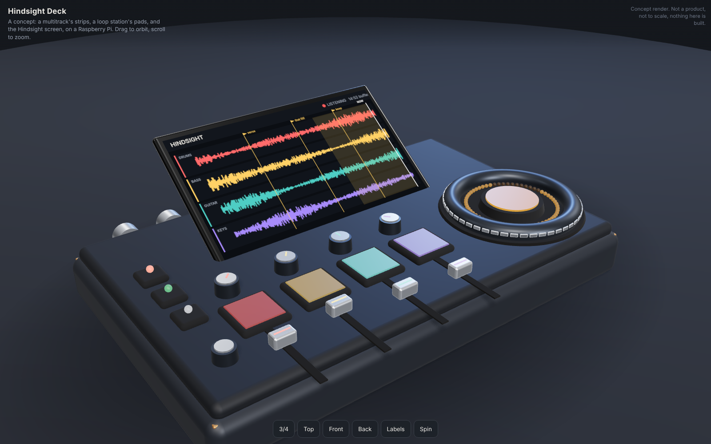

# Hindsight Deck: a concept render

An imagined device, answering the 11/20 note: *a 3D rendering of what the
offspring of a multitrack recorder, a loop station and the Hindsight webapp
would look like: an affordable "Raspi on steroids" interactive device.*



It is **not a product and nothing in it is built**. It is one picture of the
idea: Hindsight's always-listening 15-minute buffer, on a screen you can
touch, with the physical controls a player wants with their hands on an
instrument.

| | |
|---|---|
| **Screen** | the Listening Room as it is today: four tracks as waveforms, flags on the timeline, NOW at the right, the reach-back selection, a KEEP chip |
| **Four strips** | an encoder, a pad and a fader each. The pad arms and keeps that track; the colour is the track's |
| **Scrub ring** | the buffer drawn round, a bright head sweeping it. Turn it to reach back; the big button in its middle is KEEP |
| **Transport** | record, play, stop, and a headphone level |
| **Back** | four combo inputs, two outs, USB-C: an audio codec and a Raspberry Pi inside, vents down the side |

The layout is made up for this picture, not taken from any recorder or
looper, and carries no maker's name or marks.

## See it, turn it

`deck-hero.png`, `deck-top.png`, `deck-back.png` are stills. The live version
is one self-contained HTML file (three.js bundled in; no network): orbit,
zoom, preset views, a labels toggle, and the screen and LEDs animate.

```sh
mkdir /tmp/deck && cd /tmp/deck && npm init -y && npm i three esbuild
cp <repo>/docs/hardware/concept/{scene.js,page.html,build.mjs} .
mkdir src && mv scene.js page.html src/ && node build.mjs deck.html && open deck.html
```

`build.mjs` bundles `src/scene.js` into `src/page.html`'s script slot. Add
`?still` to the page's address to freeze the animation at a fixed moment, as
the stills were taken.

## Honest limits

- Proportions are guessed: no enclosure, thermal, or PCB constraints were
  looked at. The 3.5" thickness and a 7" screen are what looks right, not what
  has been costed.
- "Affordable" is a hope, not a number. A Pi, a 7" touchscreen, a four-input
  codec, four faders and a ring of LEDs is a bill of materials that someone
  should add up before this goes further.
- Colours and materials (brass trim, knurled ring) are a mood, not a spec.
